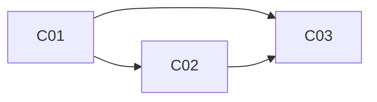

# 금액 계산의 정밀도 — 설계서

독자: 실무 3~5년차 Java·Spring 백엔드 개발자. 깊이: 압축(장당 15분).

## 학습 경로

double로 금액을 다루면 어디서 틀리는지 본 뒤(01), 그 문제를 푸는 `BigDecimal`의 표현과 생성 경로를 익히고(02), 정확한 값끼리도 어긋나는 비교와 나눗셈을 정리한다(03). 원인 → 해법 → 해법의 함정 순서다.

## 의존성 그래프

| 레벨 | 챕터 | 동시 집필 |
|---|---|---|
| 0 | 01 | — |
| 1 | 02 | — |
| 2 | 03 | — |

## 관통 사례

정산 배치 — 주문·쿠폰·환불 금액을 달러 단위로 합산해 장부와 대조한다.

- 참여 대상: 정산 배치 · 주문 서비스 · 장부
- 초기 상태: 금액 필드가 모두 `double`
- 01장: $0.10 쿠폰 10건을 합산해 $1.00과 `==`로 대조했다가 불일치로 실패
- 02장: `BigDecimal`로 바꾼 뒤 `new BigDecimal(0.1)`로 다시 불일치 · 단가 19.99 × 할인율 0.9에서 스케일이 늘어남
- 03장: 환불 검증에서 `10.0`과 `10.00`을 `equals`로 비교해 실패 · $100.00을 세 명이 분할 결제

## 용어집

| 용어 | 표기 | 최초 정의 챕터 |
|---|---|---|
| floating-point error | 부동소수점 오차 | 01 |
| precision (double) | 유효 정밀도 | 01 |
| scale | 스케일 | 02 |
| unscaled value | 비스케일 값 | 02 |
| rounding mode | 반올림 모드 | 03 |
| banker's rounding | 은행원 반올림 | 03 |

## 원래 목차에서 바꾼 것

| 바꾼 것 | 원래 | 이유 |
|---|---|---|
| 없음 | — | 원래 순서가 원인 → 해법 → 함정으로 이미 맞물린다 |

## 챕터 목록

| 번호 | 제목 | 목차 항목 | 선수 |
|---|---|---|---|
| 01 | double로 금액을 더하면 왜 틀리는가 | 1, 1.1, 1.2 | — |
| 02 | BigDecimal은 어떻게 십진 금액을 정확히 담는가 | 2, 2.1, 2.2 | 01 |
| 03 | 정확한 BigDecimal끼리 비교하고 나누면 왜 예상과 다른가 | 3, 3.1, 3.2 | 01, 02 |
